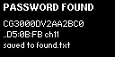

# Broadcom WPSplinter

> **Note:** this is just a write up of the exploit - I decided against publishing the code & firmware because I didn't think making a permanent day easier to exploit would be beneficial to anyone.

This work was derived from <https://qkaiser.github.io/broadcom-wps/>.

After reading about the broadcom permanent day I realized I finally had a use for my flipper zero with it's wifi module beyond just as an expensive universal remote and turn it into the Mr. Robot/watchdog esq hack tool I imagined it would be when I bought it /jk mostly. But the idea of pure OTA wifi popping really did scratch that hacker man itch in my brain as something you mostly see in movies or games. So I immediately went onto ebay and bought an old used Netgear CG3000DV2C0 that has a Broadcom BCM3380-class cable gateway. The perfect $20 target.

I received the router and immediately factory reset it. For reference the BSSID was `10:0d:7f:xx:xx:xx` and the hidden SSID was `CG3000DV2C0`. The password was a 15 character unique-to-the-router key printed on the router. I never connected the router to the broader internet or to any other device on my network.

In the end we were able to reproduce the Broadcom WPS registrar overflow documented by Quentin Kaiser ("Broadcom WPSplinter"). The PSK was recovered from the router's driver heap at `0x823bf82c` in the console runs and `0x823c1bf8` on the verified Flipper run.

<!-- Recorded run: scan, hidden-AP selection, overflow dump, recovered key. -->
<p align="center">
  
  <br>
  <sub><a href="wpsplinter-session-2026-11-17/session-2026-11-17/README.md">Recorded session notes</a></sub>
</p>

---

## Contents

- [1. The bug](#1-the-bug)
- [2. Constraints on my specific target](#2-constraints-on-my-specific-target)
- [3. Attack chain](#3-attack-chain)
  - [3.1 Find the AP](#31-find-the-ap)
  - [3.2 Associate without the key](#32-associate-without-the-key)
  - [3.3 Open the EAP-WSC session](#33-open-the-eap-wsc-session)
  - [3.4 Overflow the reassembly buffer](#34-overflow-the-reassembly-buffer)
  - [3.5 Trigger `sendNextFrag()`](#35-trigger-sendnextfrag)
  - [3.6 Walk memory](#36-walk-memory)
  - [3.7 Interpret the leak](#37-interpret-the-leak)
- [4. Where the credential lives](#4-where-the-credential-lives)
- [5. Memory map observed on this target](#5-memory-map-observed-on-this-target)
- [6. What this target demonstrates](#6-what-this-target-demonstrates)
- [7. Does it work on other routers?](#7-does-it-work-on-other-routers)
- [References](#references)

---

## 1. The bug

Broadcom's WPS registrar reassembles a fragmented EAP-WSC message into a fixed buffer:

```c
/* ap_eap_sm.h, natural 32-bit layout, abridged */
struct ap_eap_state {
    ...
    uint8    frags_received[2048];   /* +0x814  reassembly buffer */
    uint16   total_bytes_to_recv;    /* +0x1014 declared message length */
    uint16   total_received;         /* +0x1018 bytes copied so far */
    uint8   *next_frag_to_send;      /* +0x101C outbound send pointer */
    int      frag_size;              /* +0x1020 bytes left to send */
    int      ap_m2d_len;             /* +0x1024 */
    uint8   *ap_m2d_data;            /* +0x1028 */
    ...
};
```

The reassembly path trusts `total_bytes_to_recv`, which the *enrollee* supplies in the first fragment. It never checks it against `sizeof(frags_received)`.

So if you declare a 16 KiB message and only send a few kilobytes, every byte past the end of the 2048-byte buffer is written straight over `total_bytes_to_recv`, `total_received`, `next_frag_to_send` and `frag_size` - with bytes we choose.

The second half of the bug is in `ap_eap_sm_sendNextFrag()`:

```c
feapolHdr = (eapol_header_t *)(apEapState->next_frag_to_send - WPS_DATA_OFFSET);
max_to_send = apEapState->frag_size < apEapState->eap_frag_threshold
                  ? apEapState->frag_size : apEapState->eap_frag_threshold;
...
os_memcpy(feapolHdr + 1, apEapState->next_frag_to_send, max_to_send);
...
apEapState->next_frag_to_send += advance_bytes;
apEapState->frag_size          -= wps_data_sent_bytes;
```

Nothing verifies that `next_frag_to_send` still points into `msg_to_send`. You can point the next frag to send anywhere mapped, set a large `frag_size`, and the registrar will transmit `min(frag_size, threshold)` bytes read from that address - in a valid-looking EAPOL frame.

TLDR the exploit is: write a pointer and a length into the registrar's state via the reassembly overflow, then make it send a fragment. The router leaks its own memory over the air.

---

## 2. Constraints on my specific target

Four constraints had to be handled first:

- The SSID is hidden, and the AP only appears in scans as a WPS-capable BSS
- A WPS enrollee built on ESP-IDF refuses an AP whose WPS IE does not have Selected Registrar set, and otherwise wanders off to a *different* WPS AP from the scan list.
- The WPS supplicant tears the association down on its own timers: a 20 s message timeout and EAP-Failure handling both call `esp_wifi_disconnect()`. The link dies exactly when the leak ACK has to go out.
- The registrar has a fixed ~30 s EAP session budget. After that it sends `WPS FAILED` and drops the station. Seemingly specific to this router according to the LLM

---

## 3. Attack chain

### 3.1 Find the AP

We scan for beacons/probe responses with a WPS IE, then fingerprint the vendor (Broadcom OUI in the WPS IE) and we select the target is matched by BSSID.

### 3.2 Associate without the key

The ESP32 requests a normal open association with the AP's BSSID and RSN/WPA IE. Two local ESP-IDF patches make the supplicant usable as a transport:

- `wps_parse_scan_result()` is pinned to our BSSID (`g_wps_pref_bssid[]`), so the enrollee does not select a neighbour WPS AP.
- `WPS_IGNORE_SEL_REG_MAX_CNT` is lowered from 10 scans to 1, so after one scan the supplicant stops requiring Selected Registrar and accepts our AP

A third patch, `g_wps_hold_link`, makes the supplicant keep the association through WPS timeouts/failures instead of calling `esp_wifi_disconnect()`.

### 3.3 Open the EAP-WSC session

We send EAPOL-Start, answer the EAP Identity Request, and wait for the registrar's own M1 and build a valid M1 as the enrollee.

### 3.4 Overflow the reassembly buffer

The M1 is transmitted as a fragmented EAP-WSC message:

- The frag header declares a total of `total + 0x400`
- The message body is a real M1, one large vendor-extension TLV as filler, and a second vendor TLV whose value is placed so that its bytes land on `0x1014`–`0x1027` in the state object.
- `frag=256` places that control block inside fragment 7, which the registrar will ACK and continue, so the planted fields are copied and then never overwritten by a terminating fragment.

Layout of the planted control block (all integers in the target's byte order, which on this MIPS build is big-endian):

| state offset | field | planted value |
| :--- | :--- | :--- |
| `0x1014` | `total_bytes_to_recv` | non-zero, ≥ message length |
| `0x1018` | `total_received` | `12 + last_start` |
| `0x101C` | `next_frag_to_send` | `ptr` (where to read) |
| `0x1020` | `frag_size` | `0x40000000` (huge) |

Two subtleties matter:

- `total_received` must be `12 + last_start`, not `14 + last_start`: the reassembly code skips the 2-byte total-length field of the first fragment, and being 2 bytes high misaligns *every* subsequent field in the control block.
- `total_bytes_to_recv` must stay non-zero. If it is zeroed, `REASSEMBLING()` turns false and the terminating fragment is no longer treated as a fragment at all which means the registrar retransmits its last Fragment ACK forever.

### 3.5 Trigger `sendNextFrag()`

`FRAGMENTING(apEap)` is just `next_frag_to_send != msg_to_send`, so the planted pointer already makes the registrar believe it is mid-message. Next send a WSC Fragment ACK that echoes the identifier of the registrar's last EAP request. The ACK handler gets `IS_EAP_TYPE_WPS() && FRAGMENTING()` and calls `ap_eap_sm_sendNextFrag()` — which copies 1398 bytes from our pointer into a fresh EAPOL frame, with the EAP header borrowed from `msg_to_send`.

The reply of that is 1412 bytes of EAP payload: 14 bytes of borrowed header followed by 1398 bytes of router RAM. Bingo!

### 3.6 Walk memory

Each `sendNextFrag()` advances `next_frag_to_send += 1398` and decrements `frag_size -= 1398`. So we just sequentially scan and keep ACKing, and the AP keeps reading the next 1398 bytes and sending them. The firmware records the number of rounds completed and the driver resumes the next session at `ptr + rounds*1398`.

One WPS session is capped at ~26–34 rounds (~46 KB) by the registrar's own timeout (`STA_DISCONNECTED reason=204`, HANDSHAKE_TIMEOUT). So the tooling has to chain three sessions per invocation for ~120 KB per run, and sweeps successive pointers across the address space.

### 3.7 Interpret the leak

Each 1398-byte slice is logged as hex and reassembled offline into a flat memory image. The analysis looks for:

- the target's SSID / MAC pairs (WPS state and credential structures),
- live big-endian heap pointers (to find new regions worth scanning),
- WSC attribute IDs in parsed credential tables,
- printable strings next to `WPA2-PSK`/`WPA-PSK`.

---

## 4. Where the credential lives

The WPS state object in my case is at `0x818546e2` (found by the MAC signature: our MAC at +3, AP MAC at +9). Its `mc_dev` field at +0x1044 points at the wireless device context `0x823bc008`, and the per-BSS configuration sits in that heap:

| address | contents |
| :--- | :--- |
| `0x823bf6fb` | BSSID `10:0d:7f:xx:xx:xx` |
| `0x823bf7f6` | SSID `CG3000DV2C0` |
| `0x823bf817` | `WPA2-PSK` |
| `0x823bf82c` | **network key, 15 characters (redacted)** |

The neighbouring parsed WSC credential list at `0x823bcc3a` also verifies:

```text
10 26 00 01   network index = 1
10 45 00 0b   SSID, length 11          <- matches CG3000DV2C0
10 03 00 02   auth = 0x0020 (WPA2-PSK)
10 0f 00 02   encryption = 0x0008 (AES)
10 27 00 0f   network key, length 15   <- matches the key in the BSS struct
10 20 00 06   MAC address, length 6
```

---

## 5. Memory map observed on this target

| range | contents |
| :--- | :--- |
| `0x81660000`–`0x8169b0be` | ring of 86 × 1398-byte EAPOL frame buffers |
| `0x8169b0be`–`0x816b8bd8` | WLAN scan/beacon cache (own + neighbour SSIDs) |
| `0x816b8bd8`–`0x816cc894` | version strings (`Bootloader-Rev=2.4.0beta1R8`, `Wl Ver 6.37.14.87…`) |
| `0x81850000`–`0x81867358` | live WPS/EAP state, reassembled M1 |
| `0x81860000`–`0x8195xxxx` | `0xdeadbeef` allocator poison (do not rescan) |
| `0x82aa1000` | DOCSIS/SNMP MIB tables |
| `0x82b00000` | eCos timer table |
| `0x823b0000`–`0x823cb4e0` | `mc_dev` / driver heap: BSS config, station table |
| `0x82a8xxxx` | WLAN thread structs (`wl0`, spectrum-monitor thread) |

---

## 6. What this target demonstrates

The overflow gives a sequential arbitrary read at about 1.4 KB per over-the-air frame. The recovered PSK is stored in the clear because the AP needs it for WPA and for WPS thus we are able to recover it.

---

## 7. Does it work on other routers?

The bug is in Broadcom's `wps_monitor` EAP-WPS fragment reassembly, shipped in Broadcom/Cypress WLAN SDKs and used by more than 260 confirmed device entries across 32 vendors until Broadcom replaced it with hostapd in 2018. Any device still running that stack with WPS enabled is a candidate; hostapd-based WPS is not affected.

What is shared across the family (Kaiser's YARA rules describe it as a stable layout) is the state object the overflow walks into: the 0x814-byte receive buffer, declared/accumulated totals at 0x1014/0x1018, and the control block with `next_frag_to_send` and `frag_size` immediately after it. The exploit presets encode that layout, and the firmware adds:

- big-endian 32-bit MIPS and little-endian 32-bit ARM variants (`ptr_be`, `ptr_width`), plus a 4096-byte reassembly buffer variant (`ctrl_offset=0x1810`);
- automatic layout retries and a configurable seed list (`params.txt`, console `autotune`/`seeds`/`sweep`);
- an address-agnostic phase B, so a different heap base only costs time, not correctness;
- a Broadcom+WPS filter and BSSID-tail labels, so hidden APs can be picked.

What still differs per device is how cooperative the AP is: some firmware leaks only on a fraction of associations, some rate-limits WPS after repeated sessions, and a WPS-locked AP (state attribute 0x1057) will not complete the push.

Anyways you probably just want to disable WPS if you can.

---

## References

- Quentin Kaiser, *Broadcom WPSplinter* — <https://qkaiser.github.io/broadcom-wps/>
- `ap_eap_sm.c` / `ap_eap_sm.h` (Broadcom WPS monitor, leaked SDK)
